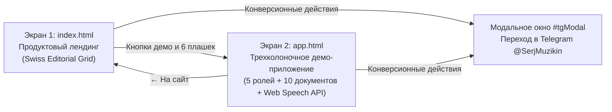

# Сервис Анти-Отчеты — Демо-прототип системы упаковки ролей (`02_anti_otchety`)

> **Автор проекта:** Сергей Музыкин (`@SerjMuzikin` | [djuls.ru](https://djuls.ru))  
> **Назначение:** Автономный интерактивный веб-прототип системы автоматизированной упаковки должностей и операционного менеджмента с помощью ИИ (`Speech-to-Text + Multi-Agent System`).

---

## 1. Архитектура и состав экранов прототипа

Прототип состоит из двух связанных экранов в единой корневой директории:



| Файл / Папка | Назначение |
| :--- | :--- |
| **[`index.html`](./index.html)** | **Экран 1:** Продуктовый лендинг сервиса «Анти-Отчеты» (5 смысловых блоков, швейцарская сетка, модальное окно `#tgModal`). |
| **[`app.html`](./app.html)** | **Экран 2:** Интерактивное трехколоночное демо-приложение упаковки ролей (5 предзаполненных должностей, голосовой ввод `Web Speech API`, желтые карточки доответа, реестр и ридер 10 управленческих документов). |
| **[`01_docs/`](./01_docs/README.md)** | Внутреннее ТЗ ([`01_task_brief.md`](./01_docs/01_task_brief.md)) и архитектурный чертеж доработки ([`02_architect_blueprint.md`](./01_docs/02_architect_blueprint.md)). |

---

## 2. Локальный запуск

Откройте [`index.html`](./index.html) или [`app.html`](./app.html) в браузере, либо запустите локальный сервер из папки `02_anti_otchety/`:

```bash
python3 -m http.server 8000
```
